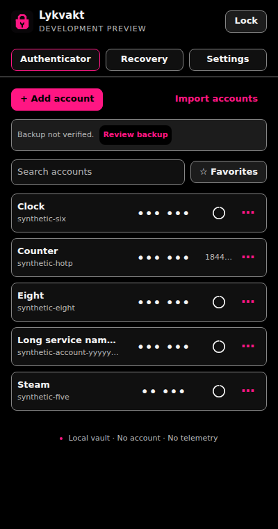

# Lykvakt

I built Lykvakt because I wanted a small authenticator for Chrome that I could use every day without giving it access to the websites I visit. It keeps your authenticator accounts in an encrypted vault on your device, with TOTP, HOTP and Steam support. I use it myself and plan to keep using and maintaining it for the long term.

The name is coined and Nordic-inspired, with the idea of watching over your keys.



## Build and test

You'll need Node 24 and Chrome 120 or newer. Lykvakt hasn't been released on the Chrome Web Store.

```sh
npm ci --ignore-scripts
npm run build
npm run lint
npm run format:check
npm test
npx playwright install chromium
npm run test:browser
```

To load the extension, open chrome://extensions, enable **Developer mode**, choose **Load unpacked** and select `dist/`. Run `npm run package` if you want an install ZIP.

CI also runs axe accessibility checks, tests switching away without locking in a browser with a visible window, and takes repeated vault-window startup measurements. The workflow runs show which checks passed.

## Using Lykvakt

Click an account row to copy its current code. Codes stay hidden until you reveal them, and hide again after 30 seconds. The optional **Next** preview follows the same rules. For HOTP accounts, the counter advances only when you confirm it in **More**.

Ctrl+Shift+Y opens or focuses the vault window, or Command+Shift+Y on Mac. You can change this at chrome://extensions/shortcuts. To copy with Enter, type part of an account name into search first. The confirmation tells you which account was copied.

Save an encrypted backup somewhere outside the browser, then choose **Verify or restore a backup** in **Recovery** to test the file you saved. Creating a backup, exporting plaintext OTP links and revealing a transfer QR all ask for your master password again.

Imports recognise supported formats and show any skipped entries before you save. The [design and recovery guide](docs/design.md) explains the formats, migration steps and compatibility limits. Steam support covers sign-in codes; it doesn't handle trade or market confirmations.

The vault stays unlocked while its window is open. In Settings, you can choose an inactivity timer; closing the window or quitting Chrome locks it. Password length is your choice, with a long, unique passphrase recommended. The app links to the [usage guide](docs/usage.md) for explanations.

## Under the hood

Argon2id runs in a worker with 64 MiB of memory, three passes and one lane. Stored costs are checked before memory is allocated. Web Crypto AES-256-GCM encrypts the account data and authenticates the header. Each save gets a fresh content key, wrapped with AES-256-KW under a separate vault key.

IndexedDB saves the new vault and its previous encrypted revision in one transaction. Revision checks reject stale writes. Changing the master password rotates the vault key and removes the old local copy in the same transaction. Recovery requires your explicit choice, and backup verification checks the actual file you select. Locking cancels pending work and clears the unlocked session.

TOTP codes can be phished, and a compromised device can read unlocked secrets. There is no password reset. The [security policy](SECURITY.md) and [reviewer brief](REVIEW.md) explain these limits and the areas that need review.

## Why I keep it small

I want bugs to have as little browser access as possible. Lykvakt has exactly one permission, `clipboardWrite`. It has no content scripts, host permissions, background script, service worker or external-message entry point. It never reads or changes web pages.

All runtime code ships with the extension. A strict CSP blocks remote scripts and external connections, and the build checks those restrictions. There is no WebAssembly, server, telemetry, advertising or subscription. Accounts and imports stay on your device, and optional tools load only when needed. The design guide and [privacy policy](PRIVACY.md) explain what is stored and where.
