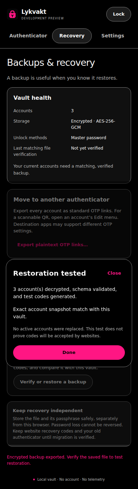
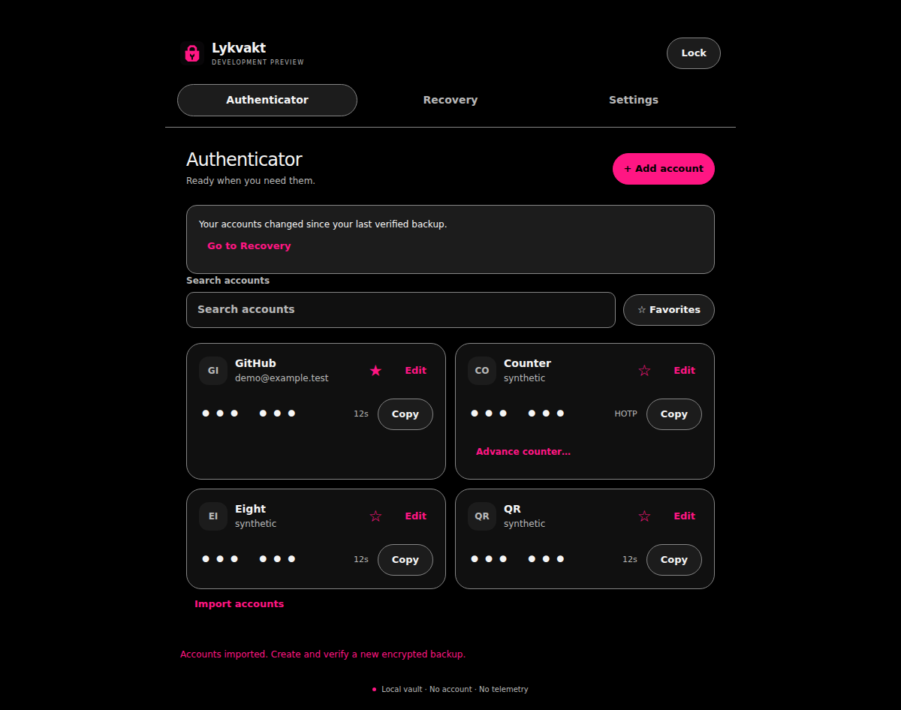

# Actual interface screenshots

Captured from the installed unpacked extension in Chrome for Testing 156 on Linux. All accounts and codes use synthetic test secrets. Every view uses the single true-black and pink appearance. These are application captures, not mockups.

The images were regenerated in [successful browser CI](https://github.com/librerob/otp-vault/actions/runs/40179546200). The later [validated build](https://github.com/librerob/otp-vault/actions/runs/40179869571) includes those files; see [validation](validation.md) for observed checks and limits.

## Authenticator

## Tested backup restoration

## Full window with eight-digit codes

