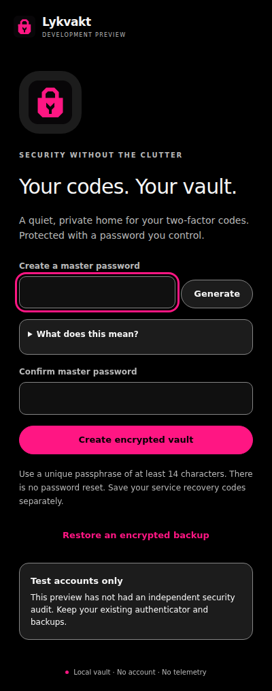
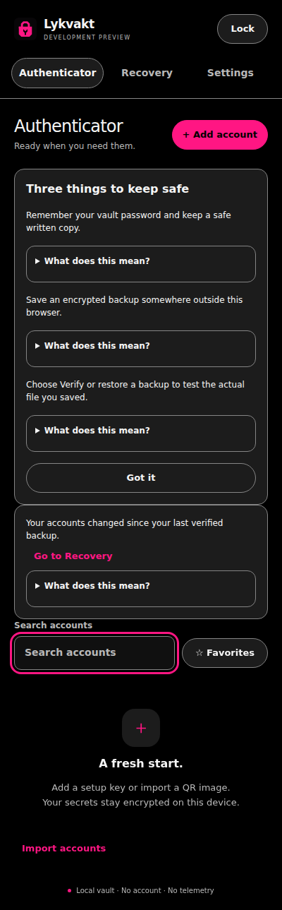
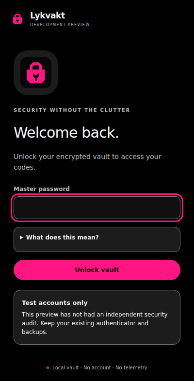
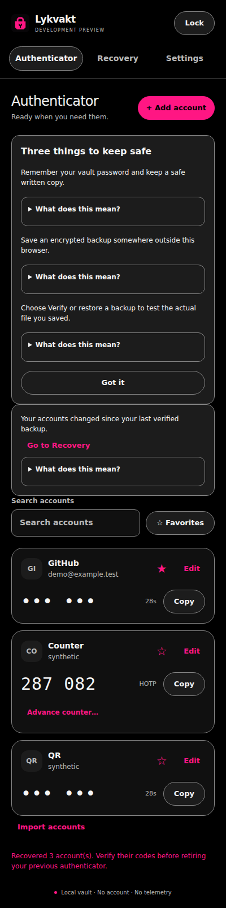

# Actual interface screenshots

Captured from the installed unpacked extension in Chrome for Testing 156 on Linux. All accounts and codes use synthetic test secrets. Every view uses the single true-black and pink appearance. These are application captures, not mockups.

These checked-in images remain available below and in the [README](../README.md). They were refreshed from the [validated feature build](https://github.com/librerob/otp-vault/actions/runs/40210914031) at commit 887a90ff641a0678766d7e6862e9a3d4c615263c; see [validation](validation.md) for observed checks and limits.

## Setup

## Empty vault

## Authenticator

## Tested backup restoration

## Full window with eight-digit codes

## Locked vault

## Recovery into a fresh profile

