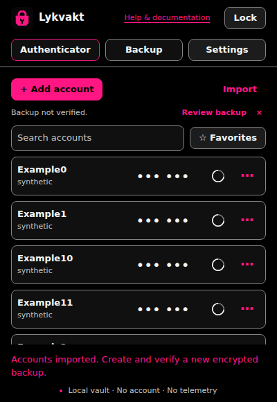
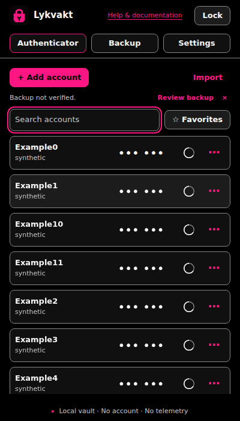

# Screenshots

These are captures of the running extension in Chromium, using synthetic accounts. They show the extension document, without browser chrome. No account details or controls were redrawn.

Every image is 400 px wide. The popup capture is 400 × 580; window captures are 400 × 700. The rendered app source is [3128a395](https://github.com/librerob/lykvakt/commit/3128a3956ec5b7d9850c770a743dcc73e10bb792). The screenshot refresh and headed test-driver correction do not change the app runtime.

## Popup

The default toolbar view keeps its header in place while the account list scrolls.

## Window

File selection uses an explicitly opened window. Its default inactivity limit is five minutes; the setting can be changed.

## Other views

- [Code controls and countdown](screenshots/accounts-expiring.png)
- [Account list](screenshots/accounts-amoled.png)
- [Empty vault](screenshots/empty.png)
- [Setup](screenshots/setup.png)
- [Locked vault](screenshots/locked.png)
- [Settings](screenshots/settings.png)
- [Verified backup](screenshots/backup-verified.png)
- [Fresh-profile restoration](screenshots/recovered-fresh-profile.png)
- [Eight-digit codes](screenshots/desktop-eight-digit.png)
- [Long names](screenshots/long-name.png)
- [Steam support](screenshots/steam-row.png)
- [Older vault format](screenshots/old-format.png)

The older-format screen refers to the old version's Recovery menu. The current app groups import, export and backups in Backup.
