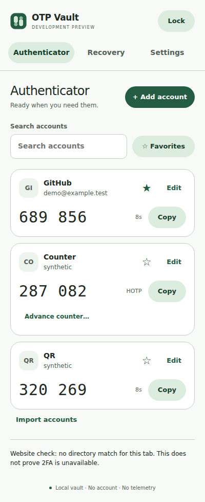
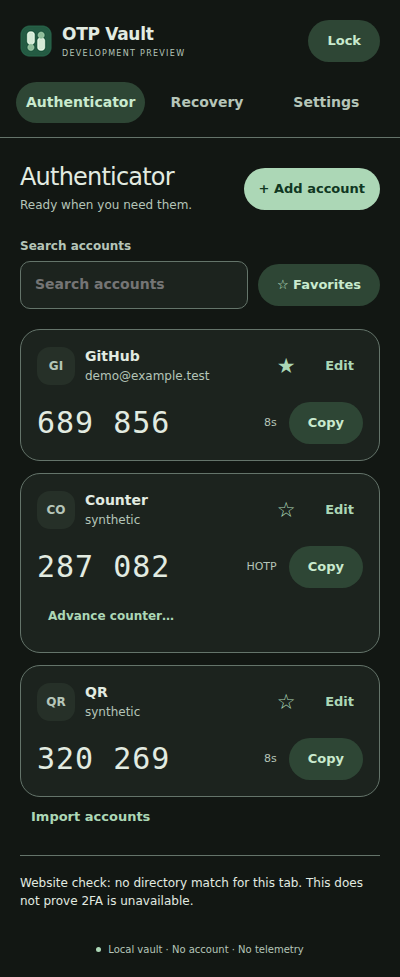

# Actual interface screenshots

Captured from the installed unpacked extension in Chrome for Testing 156 on Linux. All accounts and codes use synthetic test secrets. These are application captures, not mockups.

## Light

## Dark

## AMOLED

## Tested backup restoration

## Full window with eight-digit codes

